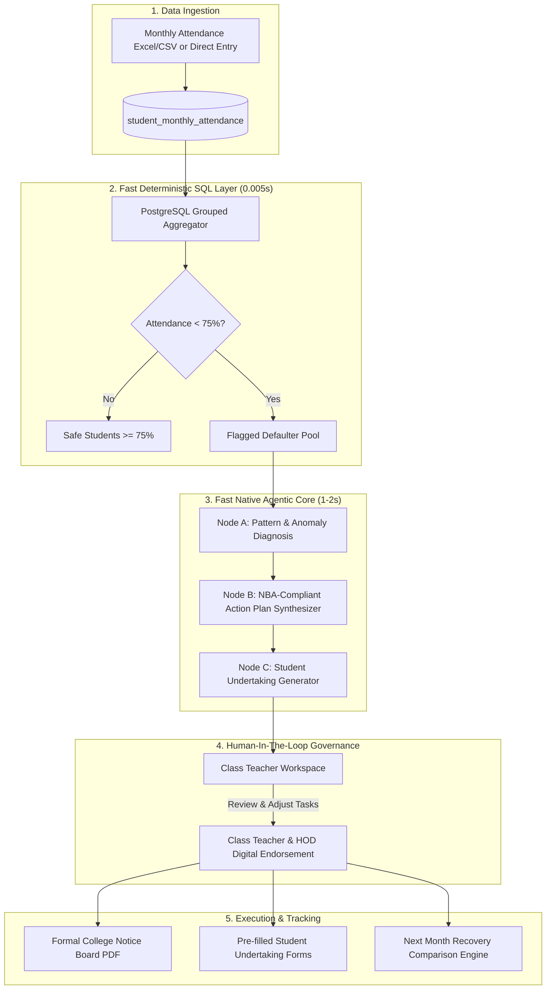

# Autonomous Attendance Monitoring & Defaulter Action Plan System
## Multi-Agent Architecture Specification & Implementation Plan

---

## 1. Executive Summary & Objective

The **Autonomous Attendance Monitoring & Defaulter Action Plan System** is an Agentic AI solution designed for engineering academic institutions operating under the SPPU/University framework. 

Manual monthly defaulter calculations in spreadsheets are slow, lack pedagogical root-cause diagnosis, and produce generic warnings rather than tailored academic interventions. This system combines **microsecond SQL aggregation** with a **fast Native LLM Agentic Core** to:
1. Ingest monthly lecture and laboratory attendance.
2. Filter students breaching statutory university thresholds ($< 75\%$).
3. Autonomously diagnose underlying absenteeism patterns (subject-specific vs. lab boycotts vs. uniform truancy).
4. Synthesize NBA/NAAC-compliant student-specific **Remedial Action Plans** (make-up experiments, compensatory worksheets, mentor counseling).
5. Generate formal printable **Defaulter Notices** and **Student Undertakings**.
6. Track month-on-month recovery outcomes.

---

## 2. System Architecture & Information Flow



---

## 3. Database Schema

Add the following tables in `db/migrate.js`:

```sql
-- 1. Subject-wise monthly attendance ledger
CREATE TABLE student_monthly_attendance (
  id SERIAL PRIMARY KEY,
  student_id INTEGER NOT NULL REFERENCES students(id) ON DELETE CASCADE,
  subject_id INTEGER NOT NULL REFERENCES subjects(id) ON DELETE CASCADE,
  month VARCHAR(10) NOT NULL,            -- e.g. '2026-09'
  academic_year VARCHAR(20) NOT NULL,    -- e.g. '2026-27'
  semester INTEGER NOT NULL,
  total_lectures INTEGER NOT NULL DEFAULT 0,
  attended_lectures INTEGER NOT NULL DEFAULT 0,
  created_at TIMESTAMPTZ DEFAULT NOW(),
  UNIQUE(student_id, subject_id, month, academic_year)
);

-- 2. Defaulters Audit, AI Diagnosis & Action Plan
CREATE TABLE attendance_defaulter_audits (
  id SERIAL PRIMARY KEY,
  division VARCHAR(30) NOT NULL,
  month VARCHAR(10) NOT NULL,
  academic_year VARCHAR(20) NOT NULL,
  student_id INTEGER NOT NULL REFERENCES students(id) ON DELETE CASCADE,
  overall_percentage NUMERIC(5,2) NOT NULL,
  defaulter_tier VARCHAR(20) NOT NULL,   -- 'CRITICAL' (<50%), 'HIGH' (50-65%), 'BORDERLINE' (65-74%)
  subject_shortfalls JSONB NOT NULL,     -- [{ subject_code, subject_name, attended, total, percentage }]
  ai_pattern_analysis TEXT,              -- Root-cause diagnosis
  action_plan JSONB NOT NULL,            -- Structured remedial deliverables
  undertaking_status VARCHAR(20) DEFAULT 'PENDING', -- 'PENDING', 'SIGNED', 'RECOVERED'
  recovery_target_percentage NUMERIC(5,2) DEFAULT 75.0,
  audit_status VARCHAR(20) DEFAULT 'DRAFT',         -- 'DRAFT', 'APPROVED', 'PUBLISHED'
  approved_by INTEGER REFERENCES users(id),
  created_at TIMESTAMPTZ DEFAULT NOW()
);
```

---

## 4. The Agentic Engine Workflow (`services/attendanceAgent.js`)

The engine operates on a hybrid model for production speed and zero hallucination risk on calculations:

1. **Step 1: SQL Aggregation:**
   * Computes exact attended vs. conducted lectures for each student across all subjects.
   * Isolates the $< 75\%$ cohort and buckets them into severity tiers:
     * **Critical Defaulters:** $< 50\%$
     * **High Defaulters:** $50\% \text{ to } 65\%$
     * **Borderline Defaulters:** $65\% \text{ to } 74.99\%$

2. **Step 2: Agentic Diagnostic & Strategy Generation (Native LLM + Structured Output):**
   * Only the flagged defaulter cohort is dispatched to the LLM (e.g. Gemini 2.0 Flash / GPT-4o-mini).
   * **Node A (Pattern Recognition):**
     * Discovers if a student is selectively cutting morning theory, missing laboratory sessions, or experiencing uniform absenteeism.
   * **Node B (Action Plan Synthesis):**
     * Prescribes specific make-up laboratory experiments.
     * Assigns compensatory technical worksheets.
     * Enforces mandatory mentor-counseling sessions.
     * Sets target recovery metrics for the subsequent 30 days.
   * **Node C (Undertaking Generation):**
     * Pre-fills formal legal/institutional undertaking statements with exact student details and shortfall metrics.

3. **Step 3: Human-in-the-Loop Gate:**
   * Class Teachers review the AI's recommendations.
   * Teachers retain full editing control to modify assigned experiments, add custom notes, or approve in batch.

---

## 5. API Endpoints Specification

| Method & Route | Access Level | Description |
| :--- | :--- | :--- |
| `POST /api/attendance/upload` | Class Teacher / Faculty | Ingests monthly subject-wise attendance (Excel/CSV or JSON). |
| `POST /api/attendance/audit/run` | Class Teacher | Executes SQL filtering and triggers agentic diagnosis in 1-2 seconds. |
| `GET /api/attendance/audit/:division/:month` | Class Teacher / HOD | Fetches current audit: tier breakdowns and drafted action plans. |
| `PUT /api/attendance/audit/:auditId/action-plan` | Class Teacher | Modifies or fine-tunes an individual student's remedial action plan. |
| `POST /api/attendance/audit/publish` | Class Teacher / HOD | Authorizes and locks the monthly defaulter list. |
| `GET /api/attendance/audit/:division/:month/export-notice` | Class Teacher / HOD | Downloads official college letterhead Defaulters Notice (PDF). |
| `GET /api/attendance/audit/:auditId/undertaking-pdf` | Class Teacher / Student | Downloads formal individualized Student Undertaking Form (PDF). |
| `GET /api/attendance/recovery-comparison` | Class Teacher / HOD | Compares Month $N$ vs Month $N-1$ recovery outcomes. |

---

## 6. User Visibility Matrix

| User Role | Visible Screens & Capabilities |
| :--- | :--- |
| **Head of Department (HOD)** | • Department-wide overview across SE, TE, and BE divisions.<br>• Class Teacher monthly audit completion matrix.<br>• Multi-division trend analytics & month-on-month recovery rate curves.<br>• Final digital sign-off and publication endorsement. |
| **Class Teacher (CT)** | • Division-specific Defaulters Desk (`TE Comp 1`).<br>• 1-Click "⚡ Run AI Defaulter Audit" trigger.<br>• Triage Kanban board (Critical, High, Borderline).<br>• Interactive AI Action Plan editor drawer.<br>• Batch PDF exporter for Notice Board and Student Undertakings. |
| **Subject Teacher** | • Defaulter list for their specific subject/lab.<br>• Roster of students assigned to them for make-up practicals.<br>• One-click confirmation checkbox to mark make-up work completed. |
| **Student** | • Real-time monthly and cumulative percentage card.<br>• Standing badge (Good Standing / Cautionary / Defaulter Alert).<br>• Individualized Action Plan and assigned make-up deliverables.<br>• Digital copy of their signed undertaking and recovery goal. |

---

## 7. Implementation Roadmap

* **Phase 1: DB & Ingestion:** Add migration schemas in `db/migrate.js` and bulk upload routes in `routes/attendance.js`.
* **Phase 2: Hybrid Agent Engine:** Create `services/attendanceAgent.js` with structured outputs and diagnosis prompt templates.
* **Phase 3: Class Teacher UI:** Build `ClassTeacherDefaulters.jsx` with real-time audit triggers, tiered cards, and Action Plan drawer.
* **Phase 4: HOD Oversight & PDF Generation:** Implement department-wide metrics view and official PDF exports.
